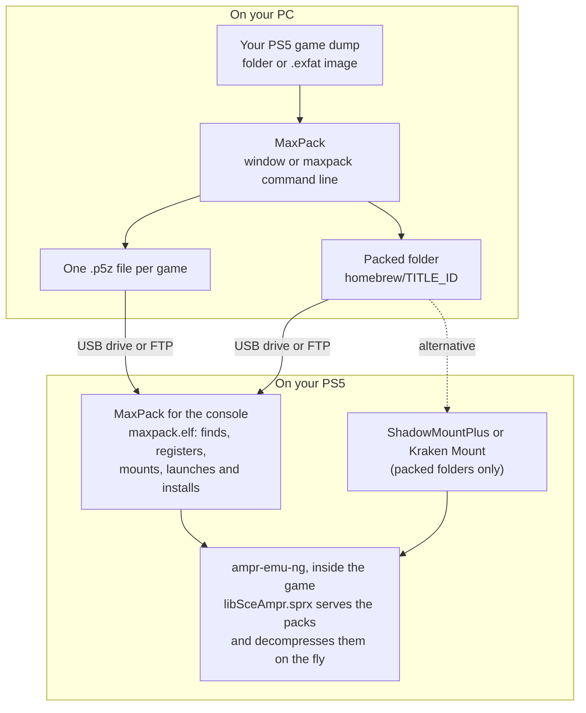
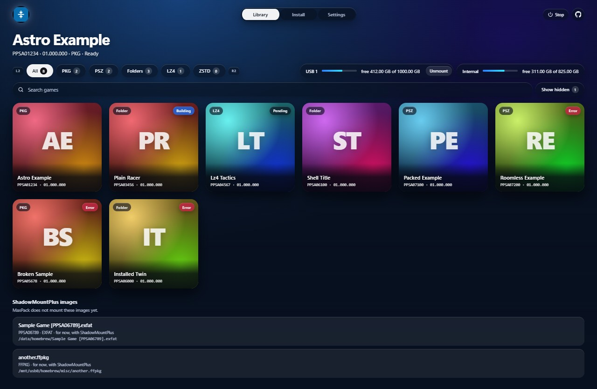
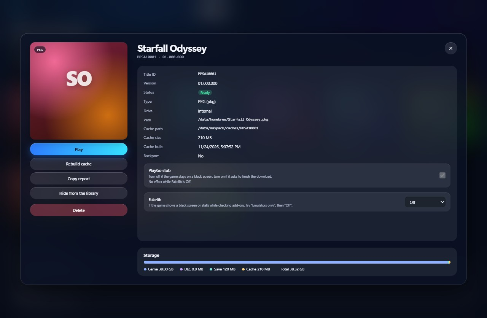
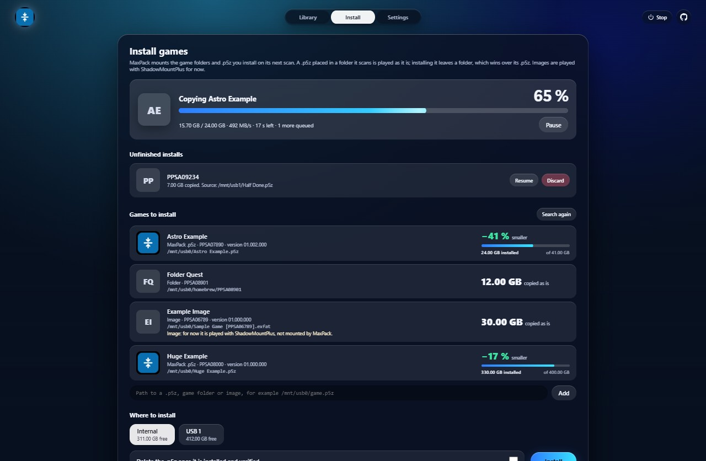
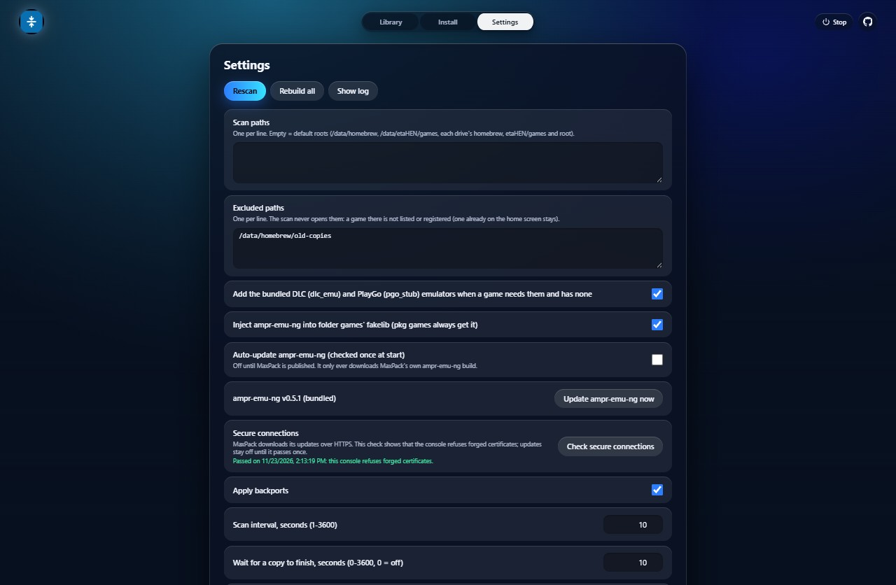
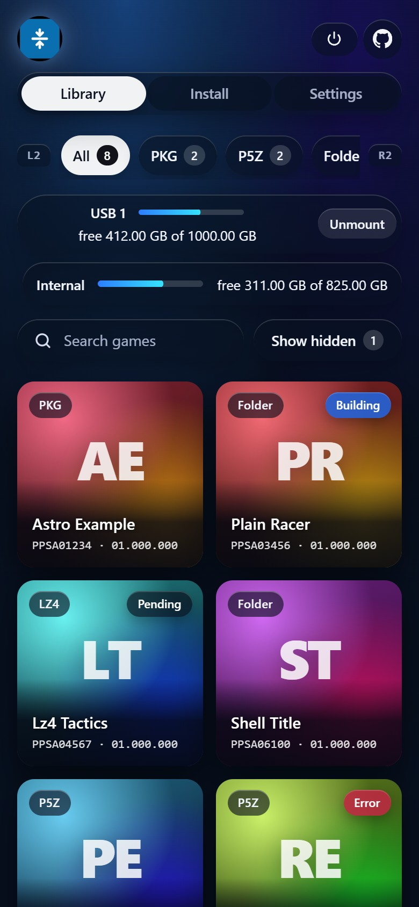

<p align="center"></p>

<h1 align="center">MaxPack for the console</h1>

<p align="center"><b>Play a PS5 game you own straight from one compressed <code>.p5z</code> file, about half its size, without unpacking it. It also mounts, launches and installs your other backups.</b></p>

<p align="center">
  <a href="https://ko-fi.com/delfus77"></a>
  <a href="LICENSE"></a>
  <a href="https://github.com/DeLFuS77/maxpack-ps5/releases"></a>
  <a href="https://github.com/DeLFuS77/maxpack-ps5/actions/workflows/build.yml"></a>
  
</p>

<p align="center">
  <a href="https://github.com/DeLFuS77/maxpack-ps5/releases/latest"><b>Download maxpack.elf</b></a> ·
  <a href="https://github.com/DeLFuS77/maxpack/blob/main/docs/guide.md"><b>User guide</b></a> ·
  <a href="https://github.com/DeLFuS77/maxpack"><b>MaxPack for the PC</b></a> ·
  <a href="docs/compatibility.md"><b>Compatibility</b></a>
</p>


- **Played on a real PS5.** Three games started straight from their `.p5z` on firmware 13.60, from the
  internal SSD and from an external M.2 SSD over USB-C ([results](#tested-on-a-real-ps5)).
- **40–70 % smaller** on those games, with nothing unpacked: 7.8 → 2.3 GiB, 69.0 → 33.2 GiB and
  124.4 → 74.1 GiB.
- **Ready in seconds.** Only the small loose files go to the internal SSD, once (213 MB in 3.4 s,
  337 MB in 6.4 s); the packs are read from the `.p5z` while you play.
- **Fakelib per game**, new in 1.0.0: **Full**, **Emulators only** or **Off**, for a game that shows a
  black screen or stalls while checking add-ons ([more](#fakelib-per-game)).
- **Recommended settings**, new in 1.0.2: a game known to need a Fakelib mode gets it by itself, and a game
  that takes minutes on a black screen says so when it starts ([more](#recommended-settings)).

> [!NOTE]
> **Status: early release, help us test.** MaxPack 1.0.2 is the current release (1.0.0 was the first public one). It has
> been tested on one console (firmware 13.60) with a handful of games, so expect rough edges. Testing
> on other firmwares, games and drives is the most useful help right now:
> [here is how](#help-test-maxpack).

<p align="center">
  <a href="https://ko-fi.com/delfus77"></a>
  <br>
  <sub>❤️ Free and open source, and it will stay free. If it saves you time, a coffee helps keep it going.</sub>
</p>

**MaxPack for the console** is a payload (`maxpack.elf`) for a jailbroken PS5. It finds your games on
the internal SSD, the M.2 drive and USB drives, puts them on the home screen, mounts them when they
start and installs them, all from a web page you open on the PS5 browser, your phone or your PC.

It is based on quer3q's [Kraken Mount](https://github.com/quer3q/kraken-mount), keeps its history and
its licence, and adds what only MaxPack does: **playing a MaxPack `.p5z` in place**, an **installer**
with space checks and resume, a richer **library page**, a **Fakelib setting per game**, and the
ability to **live next to ShadowMountPlus and Kraken Mount**.

**New to MaxPack? Start at the hub,** [DeLFuS77/maxpack](https://github.com/DeLFuS77/maxpack): it has
the PC app that makes the `.p5z`, the [quick start](https://github.com/DeLFuS77/maxpack#quick-start),
the [complete guide](https://github.com/DeLFuS77/maxpack/blob/main/docs/guide.md) and the short story
of [why MaxPack exists](https://github.com/DeLFuS77/maxpack#why-maxpack-exists).

## Contents

- [Why it exists](#why-it-exists)
- [Why .p5z](#why-p5z)
- [Tested on a real PS5](#tested-on-a-real-ps5)
- [Storage advice](#storage-advice)
- [Requirements](#requirements)
- [Quick start](#quick-start)
- [The MaxPack family](#the-maxpack-family)
- [Features](#features)
- [Fakelib per game](#fakelib-per-game)
- [Recommended settings](#recommended-settings)
- [Trust and updates](#trust-and-updates)
- [Documentation](#documentation)
- [FAQ](#faq)
- [Status](#status)
- [Building](#building)
- [Help test MaxPack](#help-test-maxpack)
- [Legal and disclaimer](#legal-and-disclaimer)
- [Credits and licence](#credits-and-licence)

## Why it exists

PS5 games are huge and the console's storage is not. [MaxPack for the PC](https://github.com/DeLFuS77/maxpack)
already shrinks a game into zstd packs, often to a fraction of its size, as a single `.p5z` file. But
a compressed game is only useful if the console can **play it while it stays compressed**.

That needs someone on the console to:

- **find** the games, wherever they are (internal SSD, M.2, any USB drive) and whatever form they have
  (a folder, a debug FPKG, a `.p5z`);
- **register** them on the home screen like any other game, and **mount** them at launch;
- **feed the game** its files from the packs, through the runtime (ampr-emu-ng) loaded inside the game;
- for a `.p5z`, do all that **without unpacking the file**: copy only its few loose files to the
  internal SSD and read everything else from the `.p5z` where it is.

MaxPack for the console does all of that, and adds an installer for when you want the game on the
console's own storage.

## Why .p5z

- **One file per game**, 40–70 % smaller on the games tested, with the SHA-256 of every file inside
  (`maxpack verify` checks them all on the PC).
- **Plays without unpacking.** Only the small loose files (`eboot.bin`, modules, `sce_sys/`...) are
  copied once to the cache on the internal SSD; the packs are read from the `.p5z` while you play.
- **Easy to keep and move** on the PC, and never a dead end: `maxpack unpack --folder|--original` turns
  it back into a packed folder or the original dump, bit for bit, whenever you want.
- **Played by MaxPack for the console.** ShadowMountPlus and Kraken Mount do not read a `.p5z`; for
  them, the Install tab turns it into a packed folder on the console.
- **Over 4 GiB** (most are), a `.p5z` needs an exFAT drive or the internal SSD: FAT32 cannot hold it.

The full comparison with dump folders, `.exfat` and `.ffpkg` images is in the hub:
[Why .p5z](https://github.com/DeLFuS77/maxpack#why-p5z).

## Tested on a real PS5

24 November 2026, one PS5 on firmware 13.60, with MaxPack for the console. Each game was played straight
from its `.p5z`, without unpacking it:

| | Original → `.p5z` | Smaller by | Volumes | Drive | Loose files in the cache | Result |
|---|---|---|---|---|---|---|
| **Game A** | 7.8 → 2.3 GiB | 70 % | 1 | Internal SSD | 213 MB, ready in 3.4 s | Plays, saves and loads |
| **Game B** | 69.0 → 33.2 GiB | 51 % | 9 | External M.2 SSD over USB-C | 337 MB, ready in 6.4 s | Played without problems |
| **Game C** | 124.4 → 74.1 GiB | 40 % | 19 | The same M.2 SSD | | Reaches the main menu and opens its saves, with only ampr-emu-ng in its `fakelib/` (what Fakelib **Off** does) |

<sub>Sizes in GiB, as the console page shows them.</sub>

- **On the PC**, game B (74 GB) became a 35.5 GB `.p5z` in 14.5 minutes at zstd 19 on a 32-thread
  PC, and `maxpack verify` checked it in 70 s.
- **Reads from the `.p5z`** took about 2 ms each on average on the M.2 SSD. A launch reads about
  1.5–2.5 GB in its first 20 s.
- **A mechanical USB hard drive is far too slow** for a large `.p5z`: the game never got past its first
  screen. See [Storage advice](#storage-advice).
- **Game C needed Fakelib Off.** With the backport libraries its dump carries, or with a bundled
  emulator, it did not get that far on this console. During the test its `fakelib/` was set by hand to
  hold only ampr-emu-ng, which is what [Fakelib](#fakelib-per-game) **Off**, new in 1.0.0, does for you.

Every game tried, with firmware, mounter and result, goes into the
[compatibility list](docs/compatibility.md). Tried one? Open the game's sheet, press **Copy report** (it
ends with the row, which names no game) and paste that row in a
[Game report](https://github.com/DeLFuS77/maxpack-ps5/issues/new?template=game_report.yml), whether it
worked or not. How much MaxPack for the PC saves on other games, measured on the PC, is in the
[engine's report](https://github.com/DeLFuS77/maxpack/blob/main/docs/reports/phase1.md).

## Storage advice

Where the `.p5z` sits decides how fast the game can read it:

| Drive | For a `.p5z` |
|---|---|
| **Internal SSD** (`/data/homebrew`) | The best. |
| **External SSD or M.2 over USB 3, on a 10 Gbps port** | Works well: games of 33 and 74 GiB ran from an M.2 SSD over USB-C, at about 2 ms per read. |
| **Mechanical USB hard drive** | Not recommended: a large `.p5z` was far too slow to get past its first screen. |

- Format external drives **exFAT**: FAT32 cannot hold a file over 4 GiB, and most `.p5z` files are
  bigger. Packed folders (MaxPack's "Play from the USB") split their packs into parts that fit FAT32.
- Wherever the `.p5z` is, the packs never leave it: the internal SSD holds only the loose files, and
  needs them plus 256 MiB free.

## Requirements

- A **jailbroken PS5** with **kstuff** loaded and an **ELF loader on port 9021** (elfldr, etaHEN or a
  payload manager). Tested so far on firmware 13.60.
- Games you own: dump folders, debug FPKGs, or `.p5z` files made by
  [MaxPack for the PC](https://github.com/DeLFuS77/maxpack).
- For a `.p5z`, a fast drive: the internal SSD, or an SSD on a 10 Gbps USB port, formatted **exFAT** for
  any `.p5z` over 4 GiB ([storage advice](#storage-advice)).
- To open the page: the PS5 browser, or a phone or a PC on the same network.
- Not needed: ampr-emu-ng, the DLC emulator and the PlayGo stub are all inside `maxpack.elf`.

## Quick start

1. Download `maxpack.elf` and `SHA256SUMS` from [Releases](https://github.com/DeLFuS77/maxpack-ps5/releases)
   and check the file: `sha256sum -c SHA256SUMS`, or its build attestation
   ([how](#trust-and-updates)).
2. Put your `.p5z` files on the console: in `homebrew/` of the internal SSD (`/data/homebrew`, over FTP
   in binary mode), or in the root or `homebrew/` of an exFAT SSD plugged into the PS5.
3. With kstuff loaded, send `maxpack.elf` to the ELF loader: `nc -w 3 <PS5 IP> 9021 < maxpack.elf`,
   or use your payload loader.
4. Open `http://<PS5 IP>:8095` in a browser, or the **MaxPack** tile on the home screen.
5. Open a game and press **Play**, or start it from the home screen. The first time, MaxPack copies its
   loose files to the cache (seconds on the games tested).

MaxPack keeps a copy of itself in `/data/maxpack/maxpack.elf`, so later the home-screen tile starts it
by itself. Step by step, with troubleshooting:
[the guide, section 5](https://github.com/DeLFuS77/maxpack/blob/main/docs/guide.md#5-maxpack-on-the-console).

> **Upgrading from the old phase-2 `maxpack.elf`?** It used the same name and port but cannot hand the
> port over. Remove it from every autoload list and restart the console first, or the new one stops
> with "port 8095 busy".

## The MaxPack family

MaxPack is made of three projects that work together. Each one lives in its own repository and has
its own releases. The hub is [DeLFuS77/maxpack](https://github.com/DeLFuS77/maxpack): start there.



| Repository | Runs on | What it does |
|---|---|---|
| [**DeLFuS77/maxpack**](https://github.com/DeLFuS77/maxpack) | PC: Windows, macOS, Linux | Compresses a dump into zstd packs (one `.p5z` or a ready-to-play folder), verifies it and gives back the original bit for bit. Hosts the user guide. |
| [**DeLFuS77/maxpack-ps5**](https://github.com/DeLFuS77/maxpack-ps5) | PS5, as a payload | `maxpack.elf`: finds games, puts them on the home screen, mounts and launches them, plays a `.p5z` without unpacking it and installs games, from a web page on port 8095. |
| [**DeLFuS77/ampr-emu-ng**](https://github.com/DeLFuS77/ampr-emu-ng) | PS5, inside each game | `libSceAmpr.sprx`: answers the game's reads from the packs and decompresses them on the fly. MaxPack's copy adds the `p5z` mode. |

**Why three pieces?**

- **Compress on the PC, where it is fast.** Packing is heavy, multi-threaded work: a desktop CPU packs
  and checks a 133 GB game in under half an hour. It is done once, and the console never compresses
  anything.
- **The console only mounts and plays.** The payload finds games, registers them on the home screen
  and mounts them when they start. It does not rewrite the game, so a `.p5z` can stay on its USB
  drive as it is.
- **The runtime must live inside the game.** A PS5 game asks the system library `libSceAmpr` and the
  file system for its data. Only a library loaded into the game's own process, from its `fakelib/`
  folder, can answer those reads from compressed packs. That library is ampr-emu-ng, and it is a
  project of its own so that it also works under ShadowMountPlus and Kraken Mount.
- **Each piece follows its upstream.** The payload is based on quer3q's Kraken Mount and the runtime
  on quer3q's ampr-emu-ng. Keeping them apart keeps their history and their licences, and makes it
  easy to merge what upstream improves.

## Features

### Play a `.p5z` in place (only in MaxPack)

Put a `.p5z` made by MaxPack for the PC in the root of a USB drive, or in `homebrew/` of a USB drive,
the M.2 drive or the internal SSD, and it shows up as **one more game**, ready to play:

1. **Scan.** MaxPack finds the `.p5z` and checks it.
2. **Cache.** It copies only the game's loose files (executables, `sce_sys/`, `fakelib/`...), once, to
   the internal SSD, into `/data/maxpack/caches/<TITLE_ID>`, with a small `maxpack.image` that says
   where each volume sits inside the `.p5z`.
3. **Register.** The game goes on the home screen like any other.
4. **Launch.** The folder that holds the `.p5z` is mounted read-only inside the game, and MaxPack's
   ampr-emu-ng, in p5z mode, reads the zstd volumes from inside the file.

The whole flow, from packing on the PC:
[How playing a .p5z works](https://github.com/DeLFuS77/maxpack#how-playing-a-p5z-works).

- **Space is checked first.** The loose files plus 256 MiB must fit on the internal SSD. If they do
  not, the game shows "Error" with how much is missing, and mounts by itself once you free that space.
- **Damaged files are caught.** A cut or damaged `.p5z`, or one with more than 256 volumes, is listed
  apart under ".p5z files that cannot be played", with a notification. A USB drive that resets for a
  moment is retried, not reported as damage.
- **Moving is fine.** Move the `.p5z` to another drive and MaxPack recognises it ("moved to...")
  without preparing it again.
- **Any name.** File names with accents, ™ or Japanese work, as MaxPack for the PC writes them.
- **Its own runtime.** It always runs with MaxPack's ampr-emu-ng, the only one that knows this mode.
  At launch the console says `ampr-emu-ng: v0.5.1 (p5z) running`.

### A library you can browse from anywhere

<p align="center"></p>

- **Every source in one grid:** debug FPKG (`.pkg`), folders (unpacked, or packed with zstd or LZ4) and
  `.p5z` files, each card with its type and state (Ready, Building, Pending, Error).
- **Type filters** (L2/R2 to move between them), **drive pills** with free space that filter the grid,
  and **Unmount** on a USB pill to unplug it safely.
- **Search** by any part of the name or the `TITLE_ID` (case and accents ignored).
- **Hide** games you do not want to see: they stay mounted and on the home screen; **Show hidden**
  brings them back, dimmed.
- ShadowMountPlus images (`.exfat`, `.ffpkg`...) are listed apart, so you know they are there.

### A sheet for every game

<p align="center"></p>

- **Play** starts the game on the console, even from your phone. It is off while another game runs,
  while the game is not Ready, or while another mounter is running.
- **Copy report** gives a ready-to-paste text for an issue: MaxPack's version, the firmware, the
  mounter, the game, its source and state, ampr-emu-ng, the **last crash** if the game closed by
  itself, the last lines of the log and a row for the [compatibility list](docs/compatibility.md)
  (the row names no game).
- **Rebuild cache** redoes what MaxPack keeps for the game; **Delete** removes the game from the
  drive after asking you.
- **Storage** shows what the game, its DLC, its saves and its cache take.
- **Fakelib** chooses what goes into the game's `fakelib/`: **Full** (the default), **Emulators only** or
  **Off**. See [Fakelib per game](#fakelib-per-game).
- **Recommended setting** shows beside Fakelib or the PlayGo stub when the
  [recommended settings](#recommended-settings) set its value, and a game that is slow to start shows its
  notice there.
- **MaxPack libraries at launch** can be turned off for an unpacked folder game that must run as it
  is.

### An installer with space checks and resume

<p align="center"></p>

- **Installs** `.p5z` files (the packs are copied as they are, only the small loose files are
  decompressed), game folders, and `.exfat`, `.ffpkg`, `.ffpfs` and `.ffpfsc` images as they are.
- **Finds** them on every USB drive and on extended storage (in the root and one level down), and in
  `/data/maxpack/`; you can also type a path.
- **Checks space first:** each drive says whether the game fits, and if it does not, the copy does not
  start.
- **Pause and resume:** an install cut by a removed USB drive or rest mode waits under **Unfinished
  installs**, with **Resume** and **Discard**.
- **Replace safely:** the page says what will be deleted and asks; the old copy goes only when the new
  one is installed and verified.
- **Verify and uninstall** what you installed, and optionally delete the `.p5z` once the game is
  installed and verified (it rereads the whole game first).

### Settings, with secure self-update

<p align="center"></p>

- **Scan paths** and **excluded paths** (the scan never opens those).
- The bundled **DLC (dlc_emu)** and **PlayGo (pgo_stub)** emulators, added to a game that needs them and
  has none; **backports**; cleaning up games whose source is gone.
- The bundled **ampr-emu-ng** (`v0.5.1-maxpack.2`), with its own updater (off until MaxPack is
  published), checked like the self-update.
- **Download updated recommended settings** (on by default): the latest list of
  [recommended settings](#recommended-settings), once per start.
- **Check secure connections:** proves that the console refuses forged certificates. MaxPack's
  self-update, the ampr-emu-ng updater and the recommended settings download stay off until this check
  has passed once.
- **Rescan**, **Rebuild all**, **Purge cache**, **Show log** and **Stop MaxPack**.
- **11 languages** (English, Russian, Chinese, German, Spanish, French, Japanese, Portuguese, Italian,
  Korean and Arabic): the page follows your browser or your choice, and the console notifications follow
  the console's language.

### From your phone too

<p align="center"></p>

Open `http://<PS5 IP>:8095` on any phone, tablet or PC on your network: browse the library, start a
game, install, copy a report. A **MaxPack** tile on the home screen opens the same page on the PS5,
and starts MaxPack if it is not running.

### Lives next to ShadowMountPlus and Kraken Mount

- **It waits.** While ShadowMountPlus or Kraken Mount is running, MaxPack mounts nothing and says so:
  the page and the installer keep working ("MaxPack only installs"), and what you install is
  registered in ShadowMountPlus. When the other one closes, MaxPack mounts again within seconds.
- **It adopts.** The first time, it imports the scan paths you had added by hand in them and adopts the
  games they had registered, without duplicates.
- **It leaves them alone.** It writes nothing in `/data/krakenmount` or `/data/shadowmount`: press
  **Stop MaxPack** and start the other one to go back.

### Everything Kraken Mount does

What its base, Kraken Mount 0.3.1, does, MaxPack does the same way: finding games in the usual roots,
a cache per game, registering on the home screen and mounting at launch, ampr-emu-ng, the DLC and
PlayGo emulators, backports, moved games, removing the ones that are gone, ejecting a USB drive, the
notifications and the settings. From later Kraken Mount versions it brings games that start an `*.elf`
on exit, the page coming back by itself after rest mode, the icon on FW 12+, the console fonts inside
the game, excluded paths and the `payloads.json` catalog for ps5-payload-manager.

### Protections

- It never registers or mounts a title that is **installed on the console**.
- It never scans system or data folders, and never opens excluded paths.
- Port 8095 answers only the page opened at the console's IP (or `localhost`), not other websites.
- Updates come only from this repository's releases (ampr-emu-ng's from DeLFuS77/ampr-emu-ng's), are
  checked against their `SHA256SUMS`, and only after the console has proved it refuses forged
  certificates.

### On the PC

The `.p5z` files come from [MaxPack for the PC](https://github.com/DeLFuS77/maxpack): drop your dumps,
press **Compress**, and each game is packed and verified.


## Fakelib per game

New in 1.0.0. A game's `fakelib/` holds the libraries MaxPack lays over the game's system libraries
when it starts: ampr-emu-ng, the bundled DLC and PlayGo emulators when the game needs them, and the
libraries the dump or its backport carries. In the game's sheet, **Fakelib** chooses what goes in:

| Setting | What the game gets |
|---|---|
| **Full** (the default) | Everything, as always: the dump's or the backport's libraries, the bundled emulators it needs, and ampr-emu-ng. |
| **Emulators only** | None of the dump's or the backport's libraries: only the bundled emulators it needs, and ampr-emu-ng. |
| **Off** | Only ampr-emu-ng, which a `.p5z`, a `.pkg` and a packed folder cannot run without. On an unpacked folder game, nothing: MaxPack mounts nothing at its launch (no `/data`, USB, fonts or writable `/app0` in the game's sandbox). |

**When to use it.** If a game shows a black screen, or gets stuck while checking add-ons, try
**Emulators only**, then **Off**. On newer firmware, the backport libraries a dump carries, or a
bundled emulator, may not suit that console. Game C of the [console tests](#tested-on-a-real-ps5) is
one: it reached its main menu only with ampr-emu-ng alone in its `fakelib/`, which is what **Off** does.

Only that game's `fakelib/` is rebuilt, before its next launch; other games and their caches are not
touched. The choice is kept in `config.toml` (`fakelib_emulators`, `fakelib_off`) and shows in
**Copy report**.

## Recommended settings

New in 1.0.2. Some games need a setting to start: one only reaches its menu with **Fakelib** on **Off**,
another stays on a black screen for minutes before it starts, which looks like a hang. MaxPack carries a
list of **recommended settings** per game, so those games work the first time without you having to know
what Fakelib is.

- A game's sheet shows **Recommended setting** beside **Fakelib** or the **PlayGo stub** when the list sets
  that value (only beside the one it sets). **Copy report** says so too.
- A game that is slow to start has a notice: its sheet shows it, and the console shows it as a
  notification, in its language, every time the game starts.
- **What you choose wins.** Change Fakelib or the PlayGo stub in a game's sheet and the list no longer
  applies to that game (`manual_settings` in `config.toml`). **Back to the recommended setting**, in the
  same sheet, undoes it. A game you had set by hand before 1.0.2 keeps your setting.
- The list comes inside `maxpack.elf`, so it works offline. Once per start, when the console has passed
  **Check secure connections** (a check passed while MaxPack runs counts from its next start), MaxPack
  downloads the latest list from this repository
  ([`data/recommended.json`](data/recommended.json)): only data, checked whole before it is used, and used
  only when it is newer than the one it has. Nothing about your games is sent: the whole list is
  downloaded. Settings > **Download updated recommended settings** turns the download off.
- The list names no game: each one is a code made from its title id with SHA-256, so it cannot be read at
  a glance. `node tools/recommended_key.js <TITLE_ID>` gives a title id's code. Found a game that needs a
  setting? Say so in an [issue](https://github.com/DeLFuS77/maxpack-ps5/issues) with its **Copy report**.

## Trust and updates

- **Every release** carries `maxpack.elf` and its `SHA256SUMS`, both with a GitHub build attestation
  that proves they were built by this repository's workflow from the tagged commit:
  `gh attestation verify maxpack.elf -R DeLFuS77/maxpack-ps5` checks a download. Releases are
  immutable once published: their files cannot be replaced.
- **The self-update** only takes this repository's releases, checks the `maxpack.elf` it downloads
  against that release's `SHA256SUMS`, and stays off until the console has passed **Check secure
  connections** (it must refuse forged certificates).
- **The ampr-emu-ng updater** (off by default) only takes DeLFuS77/ampr-emu-ng's releases, installs
  their `libSceAmpr.sprx` only when it matches that release's `SHA256SUMS`, and waits for the same
  **Check secure connections** (since 1.0.1).
- **The recommended settings** (since 1.0.2) download only a data file from this repository, check it
  whole before using it (size, format and values: anything else is refused and the list in use stays), send
  nothing about your games, and also wait for **Check secure connections**.

### Updates

At start, MaxPack looks at the latest release of this repository. When a newer one is out, the page
shows "MaxPack &lt;version&gt; is available": **Update** downloads its `maxpack.elf`, checks it against
that release's `SHA256SUMS` (nothing is sent when it does not match) and hands over to the new copy.
Close the running game first.

Before its first update, press **Check secure connections** in Settings: the console must refuse three
test sites with bad certificates at badssl.com and still reach badssl.com and GitHub. Until that has
passed once, nothing is downloaded or installed.

With [ps5-payload-manager](https://github.com/itsPLK/ps5-payload-manager), add
`https://github.com/DeLFuS77/maxpack-ps5/releases/latest/download/payloads.json` as a custom
repository: every release carries that catalog, with the `.elf` and its SHA-256. The page's **Update**
does not change the manager's copy, so if the manager starts MaxPack at boot, update it there too.

## Documentation

| Document | What is in it |
|---|---|
| [User guide](https://github.com/DeLFuS77/maxpack/blob/main/docs/guide.md) | The complete guide, PC and console, from download to playing, with common problems. |
| [docs/compatibility.md](docs/compatibility.md) | Games tested, with firmware, mounter and result. Add yours. |
| [docs/console-tests.md](docs/console-tests.md) | The full checklist for testing MaxPack on a PS5. |
| [DESIGN.md](DESIGN.md) | How it works: sources, caches, registering, launching, the web API, the installer. |
| [docs/dlcemu.md](docs/dlcemu.md), [docs/playgo.md](docs/playgo.md) | The bundled DLC and PlayGo emulators. |
| [docs/publishing.md](docs/publishing.md) | How a release is made. |
| [CHANGELOG.md](CHANGELOG.md) | What changed in each version. |
| [SECURITY.md](SECURITY.md) | How to report a vulnerability, and the page's exposure on your network. |

## FAQ

<details>
<summary><b>Does MaxPack touch my saves or trophies?</b></summary>

No. Saves and trophies are kept by the console's own services, outside the game files, and MaxPack
neither moves nor deletes them. Registering a game sets up its trophy data on the system the same way
ShadowMountPlus does, and **Delete** in a game's sheet removes only the game and its cache. Back up
your saves anyway: see the [disclaimer](#legal-and-disclaimer).
</details>

<details>
<summary><b>Can I use it with ShadowMountPlus or Kraken Mount?</b></summary>

Yes, but only one of them mounts at a time. While ShadowMountPlus or Kraken Mount runs, MaxPack only
installs; when it closes, MaxPack mounts again. To go back to them, press **Stop MaxPack** and start
the other one: your games, caches and settings stay as they were. Playing a `.p5z` in place works only
with MaxPack.
</details>

<details>
<summary><b>Which drive should I play a <code>.p5z</code> from?</b></summary>

The internal SSD is the best; an external SSD or M.2 over USB 3, on a 10 Gbps port, works well; a
mechanical hard drive is not recommended for a `.p5z`. Format external drives exFAT. Details and the
measured numbers: [Storage advice](#storage-advice).
</details>

<details>
<summary><b>A game shows a black screen or stalls while checking add-ons</b></summary>

Open its sheet and change **Fakelib**: try **Emulators only**, then **Off**. The backport libraries a
dump carries, or a bundled emulator, may not suit every console. See
[Fakelib per game](#fakelib-per-game). If it still fails, send a
[game report](https://github.com/DeLFuS77/maxpack-ps5/issues/new?template=game_report.yml) with its
**Copy report**.
</details>

<details>
<summary><b>FAT32 or exFAT?</b></summary>

exFAT for `.p5z` files: FAT32 cannot hold a file over 4 GiB, and most `.p5z` files are bigger. Packed
folders (MaxPack's "Play from the USB") split their packs into parts that fit FAT32.
</details>

<details>
<summary><b>Should I play the <code>.p5z</code> in place or install it?</b></summary>

In place is the normal way: it takes the least space, and the internal SSD holds only the loose files.
Install it when you want to unplug the USB drive: the installer copies the packs as they are, so the
installed game is still compressed. If both exist, the installed folder wins.
</details>

<details>
<summary><b>The game closed by itself. What now?</b></summary>

Open its sheet: it says "Last crash". Press **Copy report** and paste it in a
[game report](https://github.com/DeLFuS77/maxpack-ps5/issues/new?template=game_report.yml). The whole
log is in `/data/maxpack/maxpack.log` and at the bottom of the page.
</details>

<details>
<summary><b>Is the page safe on my network?</b></summary>

It listens on port 8095 with no password, so use it on a network you trust and never forward that
port to the internet. It answers only the page opened at the console's IP and refuses requests from
other websites. Press **Stop MaxPack** when you are not using it. See [SECURITY.md](SECURITY.md).
</details>

<details>
<summary><b>What does it mount, exactly?</b></summary>

Debug FPKGs (`.pkg`), game folders (unpacked, or packed with zstd or LZ4) and MaxPack `.p5z` files.
ShadowMountPlus images (`.exfat`, `.ffpkg`, `.ffpfs`, `.ffpfsc`) are listed and can be installed,
but MaxPack does not mount them: ShadowMountPlus plays them.
</details>

## Status

MaxPack for the console **1.0.2** is the current release (1.0.0 was the first public one). Honestly, this
is where it stands:

| Area | State |
|---|---|
| Mounting a MaxPack-packed folder on a real PS5 | **Tested** on firmware 13.60: the first build of MaxPack for the console mounted, launched and cleaned up a packed game 3 times, and going back to ShadowMountPlus worked. The same game boots, saves and loads with MaxPack's ampr-emu-ng. |
| Playing a `.p5z` in place | **Tested on a real PS5**: firmware 13.60, three games with 1, 9 and 19 volumes, from the internal SSD and an external M.2 SSD over USB-C ([results](#tested-on-a-real-ps5)). Still to do: a side-by-side timing against a packed folder, and more games, firmwares and drives. |
| Fakelib per game | Done and tested on the PC. Game C reached its menu with the same `fakelib/` that **Off** makes, set up by hand during the tests. |
| Recommended settings | Done and tested on the PC (the list's checks and the precedence in `cargo test`, the page in the mock); its pass through the console checklist (section 10) is still to do. |
| The library, Play, hide, Copy report, installer, excluded paths, living with ShadowMountPlus and Kraken Mount, the tile, the self-update | Done and tested on the PC; their pass through the console checklist is still under way. |
| Everything inherited from Kraken Mount 0.3.1 | Kept as in Kraken Mount, a released mounter; MaxPack's own pass through that part of the checklist (section B) is still to do. |

The full console checklist is [docs/console-tests.md](docs/console-tests.md), and every game tried
is in the [compatibility list](docs/compatibility.md). Tried one? See
[Help test MaxPack](#help-test-maxpack).

## Building

```
ps5/build.sh
```

It needs Docker. It builds in two stages (the first is the copy the tile starts, the second embeds it)
and leaves `target/ps5/maxpack.elf`. The Docker image is `maxpack-ps5` and uses the PS5 payload SDK
v0.45. Quick checks on the PC, without Docker:

```
cargo check --workspace --locked --target x86_64-unknown-freebsd
cargo test -p maxpack-logic
```

In CI, the `check` job also runs `tools/check_identity.sh`, which fails if an old name or path comes
back. How it is built, the rules for a change and the contract between modules are in
[DESIGN.md](DESIGN.md).

<details>
<summary><b>Identity: files, IDs and ports</b></summary>

- Binary: `maxpack.elf`; its own copy in `/data/maxpack/maxpack.elf`.
- Data in `/data/maxpack/`: `config.toml`, `maxpack.log`, `caches/<TID>`, `ampr/`, `crashes.json`,
  `recommended.json` (the last downloaded list of recommended settings), and the installer's (`state/`,
  `installed/`, `tmp/`).
- Home-screen tile: `MXPK00001`. Web page on port **8095**.
- Its own version, the one in `Cargo.toml`: 1.0.0 is the first published one; 0.1.x and 0.2.x were
  test builds. It does not follow Kraken Mount's numbering, whose 0.3.1 is the base.
- The part that talks to ampr-emu-ng keeps its upstream names (`kraken.image`, `/app0/kraken/`,
  `kraken.pkg`, `kraken_zero.dat`), and the internal crate is still called `kraken-mount-pkg`, to
  keep merges from the original easy.
- The bundled components live in `vendor/`: ampr-emu-ng, dlc_emu and pgo_stub (each with `VERSION` and
  `SHA256SUMS`), and a pinned copy of the MaxPack engine.
</details>

## Help test MaxPack

MaxPack has run on one console so far, so every report from another firmware, game or drive helps,
and a game that works is as useful to know as one that does not. English or Spanish are both fine.

- **Tried a game?** Open a
  [Game report](https://github.com/DeLFuS77/maxpack-ps5/issues/new?template=game_report.yml); you do
  not need to name the game. The row at the end of its **Copy report** fills most of it, and the result
  goes into the
  [compatibility list](docs/compatibility.md).
- **Found a bug?** Open a
  [Bug report](https://github.com/DeLFuS77/maxpack-ps5/issues/new?template=bug_report.yml) and paste
  the game's **Copy report** in it: it has the version, the firmware, the source, the last crash and
  the last log lines.
- **Always say** which firmware, drive (internal SSD, USB SSD, hard drive, M.2) and loader you used,
  and whether another mounter was running.

Problems on the PC go to [maxpack](https://github.com/DeLFuS77/maxpack/issues), problems with the
runtime to [ampr-emu-ng](https://github.com/DeLFuS77/ampr-emu-ng/issues). An idea? Open a
[feature request](https://github.com/DeLFuS77/maxpack-ps5/issues/new?template=feature_request.yml).
For a security problem, see [SECURITY.md](SECURITY.md).

## Legal and disclaimer

> [!IMPORTANT]
> MaxPack is for backups of games you own. Piracy is not supported.

- **Your own games only.** MaxPack (the PC app, MaxPack for the console and MaxPack's copy of
  ampr-emu-ng) is meant for backups of games you own, dumped from your own console, and for homebrew.
- **No content included.** It includes and distributes no games, firmware, keys or other copyrighted
  content, and it does not help you obtain any.
- **No circumvention.** It does not bypass, remove or weaken encryption, keys or DRM. It compresses,
  stores and serves the files of a dump, and never touches keys, encryption or DRM.
- **Piracy is not supported.** Issues, reports and questions about pirated content will not be
  answered.
- **No warranty.** It is free software provided "as is", without warranty of any kind, under the GNU
  General Public License v3.0 or later (see its sections 15 and 16). You use it at your own risk.
- **No liability.** The authors and contributors are not responsible for data loss, lost or damaged
  saves, damage to your console or your storage, bans of accounts or consoles, or any other problem
  that comes from using it. Keep your original dumps and back up your saves.
- **Not affiliated.** MaxPack is not affiliated with, endorsed or sponsored by Sony Interactive
  Entertainment. "PlayStation" and "PS5" are trademarks of their respective owners, as are any other
  names mentioned.

## Credits and licence

MaxPack for the console is free software under the **GPL-3.0-or-later** licence ([LICENSE](LICENSE)),
with no warranty. The third-party notices, with the Corresponding Source of every bundled component,
are in [THIRD_PARTY_NOTICES](THIRD_PARTY_NOTICES).

- **quer3q**: [Kraken Mount](https://github.com/quer3q/kraken-mount), the base of this project;
  [ampr-emu-ng](https://github.com/quer3q/ampr-emu-ng), which MaxPack bundles as its own build,
  [DeLFuS77/ampr-emu-ng](https://github.com/DeLFuS77/ampr-emu-ng); and
  [PS5 Dump Forge](https://github.com/quer3q/ps5-dump-forge), from which the Kraken decoder of
  `crates/kraken-mount-pkg` is ported.
- **drakmor**: [ShadowMountPlus](https://github.com/drakmor/ShadowMountPlus), whose ideas and code
  behind the home-screen registration, the `fakelib` overlay and the backports are ported here;
  [dlc_emu](https://github.com/drakmor/dlc_emu), the bundled DLC emulator; and
  [pgo_stub](https://github.com/drakmor/pgo_stub), the bundled PlayGo stub.
- [ps5-payload-sdk](https://github.com/ps5-payload-dev/sdk): the PS5 toolchain and libraries.
- [zstd](https://github.com/facebook/zstd) and [zlib](https://zlib.net), in the installer's engine,
  and [SQLite](https://www.sqlite.org).
